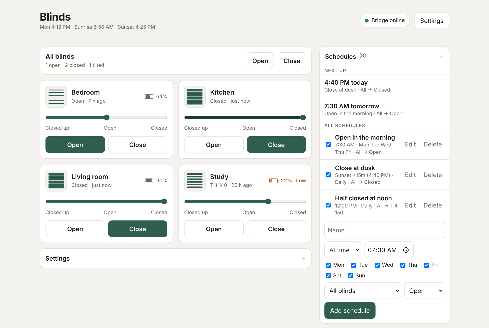
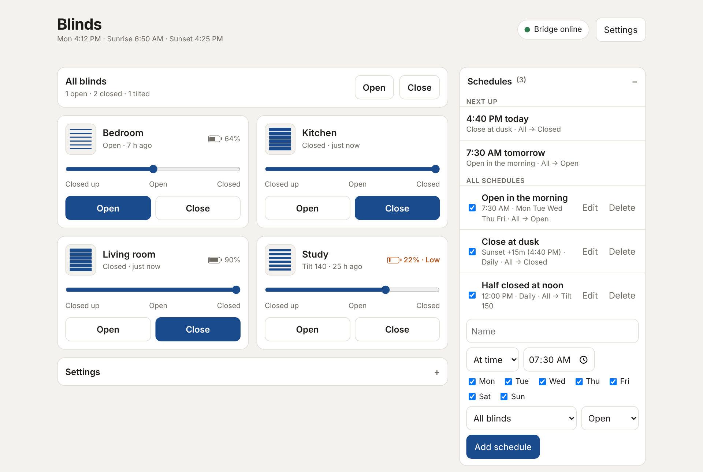
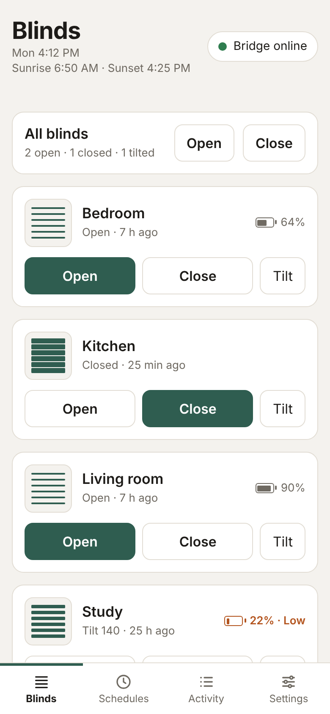
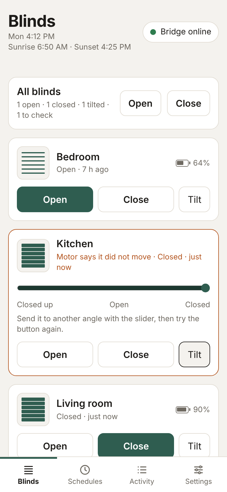
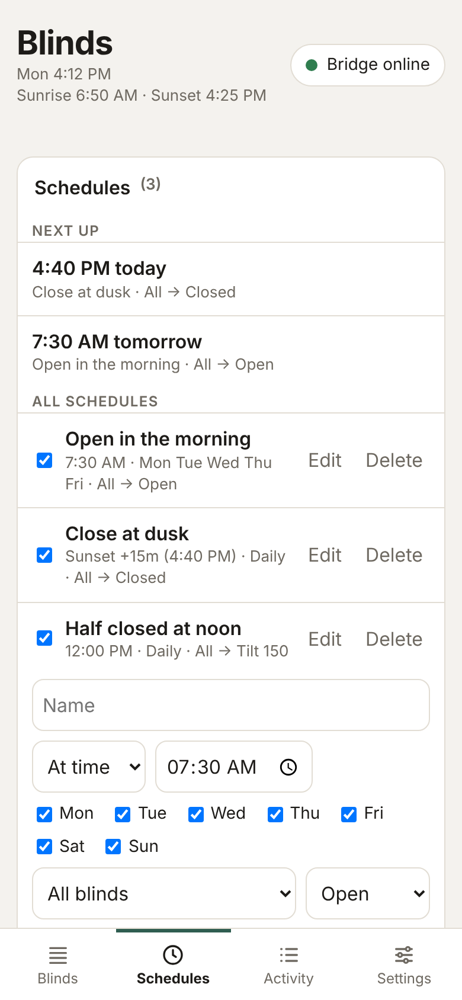
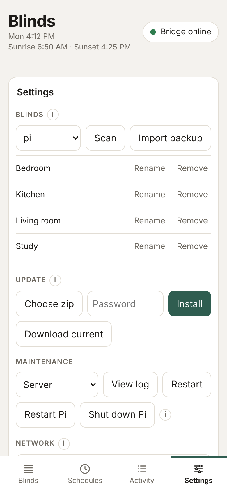

# BlindBridge


[](https://github.com/CcMarc/BlindBridge/blob/main/CHANGELOG.md) [](https://www.python.org/)
[](https://www.raspberrypi.com/)
[](LICENSE.md)
[](https://github.com/CcMarc/BlindBridge/commits/main)
[](https://github.com/CcMarc/BlindBridge/releases/latest)

A self hosted replacement for the retired MySmartBlinds bridge and cloud.

A Raspberry Pi with built in Bluetooth talks to the blind motors and serves
a small web page on your own network. Open and close each blind from your
phone, set schedules by clock time or by sunrise and sunset, and call one
API endpoint from a Shortcut or a home automation hub.

Nothing leaves your network. There is no account, no cloud and no hub to
buy. You need the Pi, your blinds and the backup file the MySmartBlinds
app can export.

## How it presents

- **Blinds**: a card per blind with a small picture of its slats, Open and
  Close, and a slider for any angle in between. The button that matches
  where the blind is now is filled in. One pair of buttons moves them all.
- **On a computer** the blinds sit in a grid with the next schedules and
  the activity log beside them. **On a phone** the same page becomes four
  tabs along the bottom.
- **After every move** the bridge listens to what the motor reports about
  itself. A blind that acknowledged a move and did not turn gets a marked
  card and a hint instead of showing the position it was sent to.
- **Battery**: a small meter on the card when the motor reports a level.
- **Schedules**: a clock time, or sunrise or sunset with an offset in
  minutes, on the days you pick, for one blind or all of them. The next
  two runs are listed first.
- **Your color and clock**: pick the accent color under Settings. Times
  read 5:30 PM or 17:30 as each device prefers, or pick one for everyone.
  Light and dark mode follow the device.
- **Settings**: scan for motors, import the app backup, rename and remove
  blinds, install an update from a zip, view logs, restart or shut down
  the Pi, and download a debug zip for troubleshooting.
- **The clock under the title** is the Pi's own time, which schedules run
  on. It turns red when the Pi has not synced its clock yet.





   

## Requirements

- A Raspberry Pi with Bluetooth LE: Pi 3, 4, 5, Zero W or Zero 2 W.
  Developed and tested on a Pi 3 Model B (see
  [Compatibility](#compatibility)).
- Raspberry Pi OS Lite, 64-bit, based on Debian 13. Python 3.10 or later
  comes with it.
- MySmartBlinds tilt motors, the kind the original MySmartBlinds bridge
  and phone app controlled.
- The backup file from the MySmartBlinds phone app. It holds each blind's
  key, and there is no other supported way to get the keys (see
  [Keys](#keys)).

The server uses the Python standard library only. The bridge needs one
package, [bleak](https://github.com/hbldh/bleak), which the install script
puts in its own environment.

## Install

1. Flash **Raspberry Pi OS Lite (64-bit)** with Raspberry Pi Imager. In
   the Imager's settings set a hostname, your user and Wi-Fi, and turn on
   SSH.
2. Download the latest release zip, unpack it, copy the folder to the Pi
   as `~/blindbridge` and SSH in.
3. Run the install script. It asks for sudo to write two service files
   and one permission rule.
   ```sh
   cd ~/blindbridge
   sh deploy/install.sh
   ```
4. Check that the Pi can see the motors. Close the phone app first,
   because a motor accepts one connection at a time.
   ```sh
   venv/bin/python bridge/bridge.py scan
   ```
5. Load your blinds and their keys from the app backup, then delete the
   copy of the backup file.
   ```sh
   venv/bin/python bridge/bridge.py import /path/to/backup.json
   venv/bin/python bridge/bridge.py list
   ```
6. Move one blind directly. This needs no server and proves the Pi and
   the keys work.
   ```sh
   venv/bin/python bridge/bridge.py move "Kitchen" close
   venv/bin/python bridge/bridge.py move "Kitchen" open
   ```
7. Create the server's settings. It asks for a password for the page and
   prints a bridge token and an API token.
   ```sh
   python3 server/server.py init --listen 0.0.0.0
   ```
8. Tell the bridge where the server is.
   ```sh
   venv/bin/python bridge/bridge.py setup --server http://127.0.0.1:8787 --token <bridge token> --name livingroom
   ```
9. Start both services.
   ```sh
   sudo systemctl enable --now blindbridge-server blindbridge-bridge
   ```
10. Open `http://<pi hostname>.local:8787` on your phone and sign in.

Logs: `journalctl -u blindbridge-bridge -f` and
`journalctl -u blindbridge-server -f`.

Use a network cable if you can. The Wi-Fi on a Pi 3 is weak and shares its
radio with Bluetooth.

If step 4 says no powered Bluetooth adapter was found, Bluetooth is soft
blocked. Run `/usr/sbin/rfkill unblock bluetooth`. The bridge service does
this by itself each time it starts.

## Upgrade

Open **Settings > Update** on the page, choose the new release zip and
confirm with your password. The zip is checked, installed, and the
services restart. Settings, schedules and keys are kept.

**Download current** saves the installed version as a zip without any
settings or keys, so there is always a copy to go back to.

A release that changes the service files says so in the changelog. Run
`sh deploy/install.sh` once over SSH after that kind of update.

## Schedules

Each schedule has a time, the days it runs on, the blinds it moves and the
position it sends them to. The time is a clock time, or sunrise or sunset
with an offset of up to six hours either way.

Sunrise and sunset need your latitude and longitude under
**Settings > Location**. Leave them empty to turn sun schedules off.
Schedules run on the Pi's own clock in the time zone set on the same
card.

A Pi has no clock battery. After a power cut without internet its time
can be wrong until it reaches a time server again, and the page shows
"clock not synced" in red until then. BlindBridge only reads that status.
It never sets the clock.

## Settings

Settings actions need a signed in browser. The API token cannot use them.

- **Blinds**: scan for motors in range, import the app backup, rename or
  remove a blind.
- **Update**: described under [Upgrade](#upgrade).
- **Maintenance**: view a service's log, restart the server or a bridge,
  restart the Pi, or shut it down before unplugging. A Pi that has been
  shut down stays off until its power is unplugged and plugged back in.
- **Network**: leave Wi-Fi on, which is the default, or have the Pi
  switch its Wi-Fi off while a network cable is plugged in and working.
  With the second choice Wi-Fi comes back by itself when the cable is
  unplugged or stops working, so the Pi can always be reached.
- **Capture**: records what a motor reports, for working out things such
  as battery level. **Download debug zip** saves the recordings, both
  logs, the page's state and the Pi's Bluetooth status as one file.
- **Appearance**: the accent color of the buttons, sliders and blind
  pictures, and 12 or 24 hour times, for every device that opens the
  page.
- **Location and password.**

The debug zip never holds the password, the tokens or the blinds' keys.
It does hold your blinds' names and Bluetooth addresses and the Pi's
network addresses, so send it to someone you trust and do not attach it
to a public issue.

## Keys

Every blind has its own key, and a motor ignores commands sent without
it. The MySmartBlinds app gained an offline backup export when the cloud
was retired. Export it from the app, copy the file to the Pi and run
`import`, or upload it under **Settings > Blinds**.

The keys end up in `bridge/blinds.json`, readable only by your user. Treat
that file and the backup file like passwords. The keys stay on the bridge.
They are never sent to the server and never packed into a download.

## A second bridge

Blinds out of range of the first Pi can be covered by another Pi that
runs the bridge only and points at the first Pi's server.

```sh
sh deploy/install.sh bridge
venv/bin/python bridge/bridge.py import backup.json
venv/bin/python bridge/bridge.py setup --server http://<first pi>.local:8787 --token <bridge token> --name upstairs
sudo systemctl enable --now blindbridge-bridge
```

Give each blind to one bridge only. Use `bridge.py remove "<name>"` on
each Pi to drop the blinds the other one covers.

A bridge installs an update sent by the server only when it reaches the
server on the same machine or over HTTPS. A second bridge that talks to
the server over plain HTTP refuses, because anything on the network
between them could change the code on the way. Update that Pi by hand, or
put `"updates_over_http": true` in its `bridge/bridge.json` if you accept
that on your network.

## Positions

Positions are in the motor's own units: `100` is open with the slats
flat, `200` is closed, `0` is closed the other way. On the command line
`open`, `close`, `up` and `half` also work.

## API

```sh
curl -X POST http://<pi>.local:8787/api/move \
  -H "Authorization: Bearer <api token>" -H "Content-Type: application/json" \
  -d '{"blinds":["all"],"position":200}'
```

That one call is enough for an iPhone Shortcut or a home automation rule.

`GET /api/state` with the same header returns the blinds, their last
known positions and the schedules. To move one blind, put its `id` from
that answer in place of `all`.

## Security

BlindBridge is built for a home network. It is not built to face the
internet.

What the Pi exposes:

- **The blinds page (port 8787)**: reachable from your network and
  anything routed to it, such as a VPN. Password protected, plain HTTP.
  Never forward a port to it.
- **SSH (port 22)**: same reach. Use a strong password, or keys only.
- **The `.local` name**: announced on the local network only.
- **Bluetooth**: the bridge makes outgoing connections to the blinds and
  nothing else. It is not discoverable.

BlindBridge makes no connections to the internet. The bridge talks to the
server, and the server talks to nobody.

What BlindBridge may do to the Pi by itself:

- **Restart or shut down the Pi.** The install script adds a polkit rule
  that lets the service's user do those two things and nothing else. The
  page's power buttons use it. So does the bridge when a blind is heard
  but cannot be connected in two tries: it restarts the Pi, at most once
  every half hour, and then carries out the move that was waiting. Put
  `"auto_reboot": false` in `bridge/bridge.json` to stop that.
- **Switch the Pi's own Wi-Fi off while a network cable is working.**
  Only if you choose that under Settings > Network, and only if the
  service's user is in the `netdev` group.
- **Install an update** that a signed in person uploads and confirms with
  the password.

`sh deploy/harden.sh` turns off the leftover NFS services Raspberry Pi OS
runs by default, installs automatic security updates and makes Bluetooth
refuse pairing. Add `--console` to also switch the graphical desktop off
if you installed the desktop edition.

To reach the page from outside the house, use a VPN into your network, or
a reverse proxy you already run that adds HTTPS. Behind Apache:

```apache
ProxyPreserveHost On
ProxyPass        / http://<pi>:8787/ timeout=60
ProxyPassReverse / http://<pi>:8787/
RequestHeader set X-Forwarded-Proto "https"
```

Then set `"trust_proxy": true` in `server/config.json`. The proxy timeout
must be longer than the bridge's 25 second wait.

To report a vulnerability see [SECURITY.md](SECURITY.md).

## Troubleshooting

- **"Motor says it did not move"**: the motor accepted the command and
  reported afterwards that it is still where it was. Use the slider on
  its card to send it to a different angle, then try Open or Close again. If
  it keeps happening, check that the tilt rod turns freely and that the
  battery is charged.
- **A move takes a minute or the Pi restarts by itself**: the Pi's
  Bluetooth software can drop a motor to a slow link that makes later
  connections time out. The bridge works around that on every move, and
  restarts the Pi as a last resort. [docs/PROTOCOL.md](docs/PROTOCOL.md)
  has the details.
- **"Clock not synced"**: the Pi has not reached a time server since it
  started. Schedules may run at the wrong time until it does. Check its
  internet connection.
- **A blind is not found**: close the phone app, which holds the motor's
  only connection while it is open, and move the Pi closer. Walls cut
  Bluetooth range down quickly.

## Compatibility

| Setup | Status |
| ----- | ------ |
| Raspberry Pi 3 Model B, Raspberry Pi OS based on Debian 13, BlueZ 5.82, Python 3.13 | Developed and tested, in daily use |
| Pi 4, Pi 5, Zero W, Zero 2 W | Should work. Same Bluetooth software, not yet tested. Reports welcome |
| Other Linux machines with a Bluetooth LE adapter and BlueZ | May work. The install script expects systemd and a Debian style system |
| MySmartBlinds tilt motors with the app's backup export | Developed and tested with two motors |
| Other motors that speak the same protocol | Unknown |

Battery level is shown when a motor reports one. A motor does not answer
on every move, so a blind's row can go without it.

## Trying it without hardware

The server runs on any computer with Python, and a pretend bridge stands
in for the Pi.

```sh
cd server && python3 server.py init && python3 server.py run
python3 tools/fake_bridge.py http://127.0.0.1:8787 <bridge token>
```

Run the second line in another terminal from the project folder.

## Tests

```sh
cd server && python3 -m unittest test_server test_updater
cd bridge && python3 -m unittest test_bridge test_netwatch
```

## Layout

```
server/      web page, schedules, API (standard library only)
bridge/      the Pi's Bluetooth side (needs the bleak package)
deploy/      install script for the two services, and harden.sh
updater.py   checks and installs an update zip
tools/       pretend bridge, and make_release.py to build the zip
docs/        PROTOCOL.md (motors and bridge to server), HARDWARE.md (the original hub's board)
images/      screenshots for this page
```

## Credits

The motor protocol was worked out in the open by others before this
project existed. These were the references:

- [tylerdurden94/MySmartBlinds](https://github.com/tylerdurden94/MySmartBlinds)
- [benbalter/smartblinds-ble](https://github.com/benbalter/smartblinds-ble)
- [poldekch/mysmartblinds-esphome](https://github.com/poldekch/mysmartblinds-esphome)

## Support

This project is provided as is, on a best effort basis. There is no
guaranteed support or response time.

- Questions and bug reports:
  [GitHub issues](https://github.com/CcMarc/BlindBridge/issues). Leave
  keys, tokens and debug zips out of public issues.

## Disclaimer

Provided as is, without warranty of any kind, under the GPL (see the
license below). BlindBridge is an independent project. It is not
affiliated with, endorsed by or supported by MySmartBlinds or its maker,
and the name is used only to say which motors it works with. You are
responsible for your own network, your Pi and your blinds.

## License

GNU General Public License v2.0, see [LICENSE.md](LICENSE.md).
